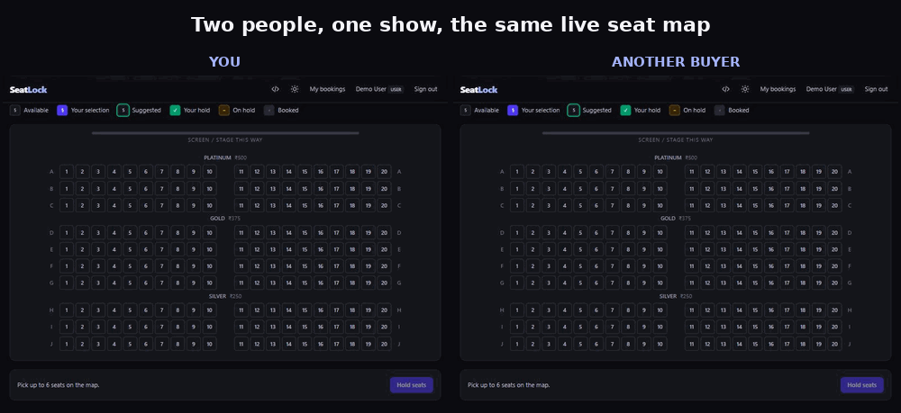
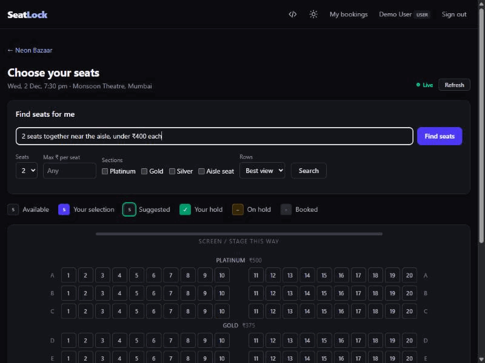
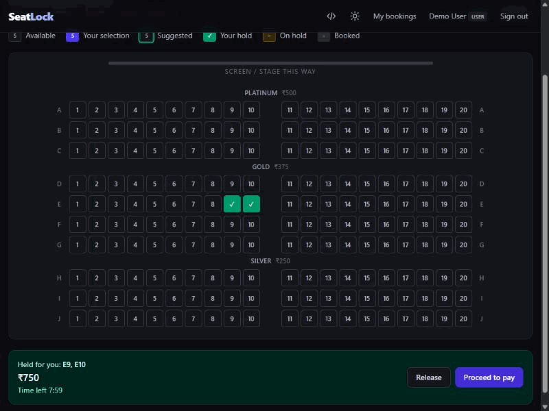
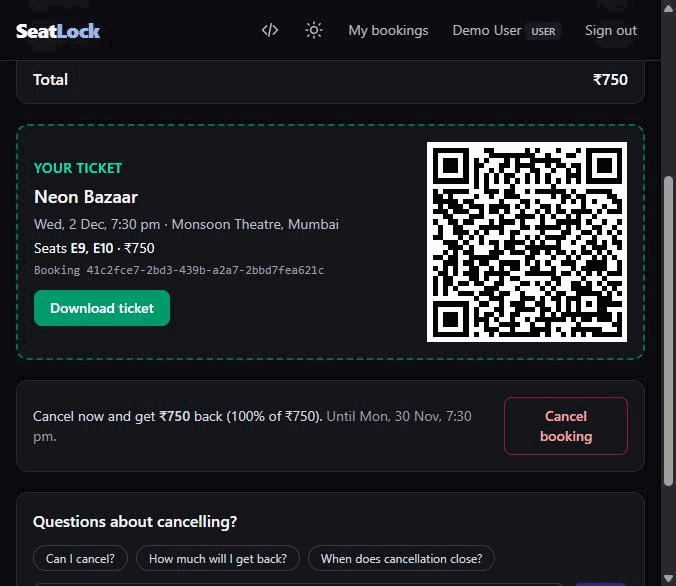
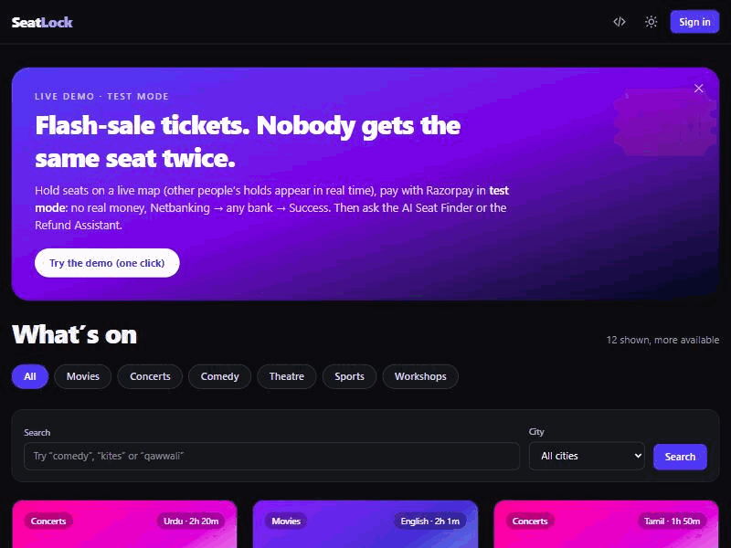
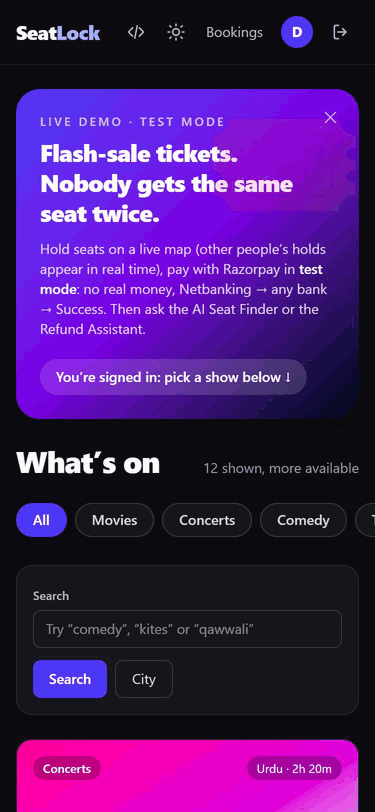
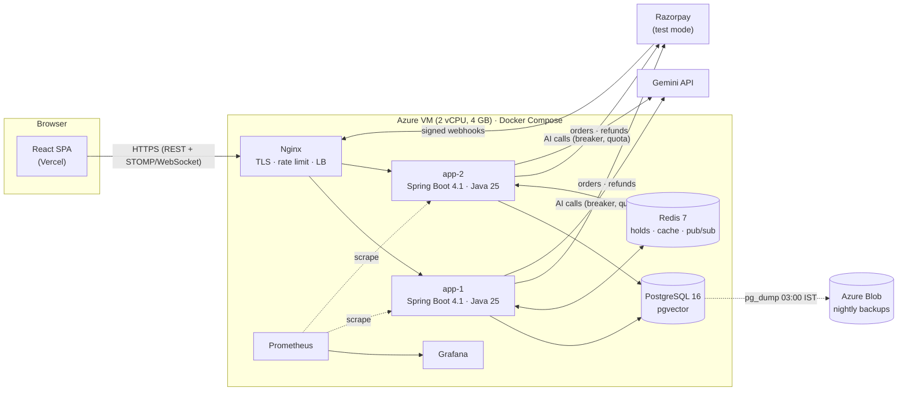

# SeatLock

[](https://github.com/prajjwalpathak/SeatLock/actions/workflows/ci.yml)
[](https://github.com/prajjwalpathak/SeatLock/actions/workflows/deploy.yml)

A flash-sale ticket booking platform where hundreds of people rush for the same seats at the same moment, and
**nobody ever gets the same seat twice**. Proven with 200-user races over real HTTP, k6 flash sales and a database
invariant that counts double-sold seats: **0 in every run**.

It also has two AI helpers that follow one rule, **AI interprets, code decides**: a Seat Finder that turns
*"2 together near the aisle under ₹800"* into validated filters for a pure-Java search, and a Refund Assistant that
explains what the refund engine computed (its ₹ amounts are checked against the engine's).

**Live:** [seatlock-nu.vercel.app](https://seatlock-nu.vercel.app) ·
API docs: [Swagger UI](https://seatlock-prajjwal.duckdns.org/swagger-ui.html) ·
running version: [/api/v1/system/version](https://seatlock-prajjwal.duckdns.org/api/v1/system/version)

| Try it as | E-mail | Password |
|---|---|---|
| User | `demo.user@seatlock.test` | `seatlock-demo` |
| Organizer | `organizer.cinema@seatlock.test` | `seatlock-demo` |

Payments run in **Razorpay test mode** (no real money): pick Netbanking → any bank → *Success*. The demo account is
shared, so its old bookings are refunded every night at 03:30 IST and seed events always get new shows.

## See it in action

Recorded on the local two-instance stack (W8·D4). How each clip was made: [docs/demo-script.md](docs/demo-script.md).

| | |
|---|---|
| **Two buyers, one live seat map.** You hold F9 + F10; the other screen shows them on hold within a second. |  |
| **AI Seat Finder.** *"2 seats together near the aisle, under ₹400 each"* → validated filters → 3 options from a pure-Java search. |  |
| **Hold → pay → ticket.** 8-minute hold, server-side price, Razorpay test checkout, QR ticket. |  |
| **Refund Assistant → cancel.** The engine computes ₹750 (100 %); the AI only explains it; cancel refunds it. |  |

<details>
<summary>More: one-click demo login, phone layout</summary>




</details>

---

## Architecture



**How a seat is sold:**
1. **Hold.** One Redis Lua script claims all chosen seats or none, with an 8-minute TTL. A second check against
   Postgres closes the window where a seat was just booked (F12).
2. **Book.** The hold becomes a `HELD` booking in one transaction. A **partial unique index**
   (`booking_seats (show_id, seat_id) WHERE active`) makes a second live claim on a seat impossible, even if Redis lost
   everything.
3. **Pay.** The server prices the booking and creates a Razorpay order. The browser's "success" is only a claim:
   the checkout signature or the HMAC-signed webhook confirms it, in one transaction that locks payment then booking.
4. **Everyone sees it.** Seat changes are published **after commit**, relayed between the two instances through Redis
   Pub/Sub with per-show version numbers; browsers resync on any gap or reconnect.

Packages are organised by feature (`identity`, `catalog`, `booking`, `payment`, `realtime`, `assistant`, `common`);
modules talk only through public services and IDs. Details: [docs/architecture.md](docs/architecture.md).

## Results (measured, not estimated)

| What | Result | How |
|---|---|---|
| **Oversells under contention** | **0** in every race and every k6 sale (up to 500 users → 10 seats) | 200-user HTTP races A/B/C, k6 per-seat thresholds, DB invariant query ([CORRECTNESS](docs/CORRECTNESS.md)) |
| Last line of defence alone | Redis bypassed, 200 DB transactions on one seat → **1 commit, 199 × unique violation** | race C |
| Duplicate payment events | 10 callbacks + 10 webhooks for one payment → confirmed **once** | `PaymentConfirmRaceIntegrationTest` |
| Locking strategy | Redis Lua **336 holds/s, p99 188 ms** vs optimistic Postgres 233 holds/s, p99 310 ms | [benchmarks](docs/benchmarks.md) section 5 |
| Virtual threads | no gain (−3 %), worse tails → left off | section 5 |
| Browse latency | p95 6–11 ms at 50 virtual users | k6, section 4 |
| Expiry sweeper at 205k bookings | **34.5 → 0.14 ms** with a partial index | `EXPLAIN (ANALYZE, BUFFERS)` |
| Startup (JDK 25 AOT cache) | **17.5 → 12.4 s median (−29 %)** | 10 restarts each, section 7 |
| Deploys | rolling, health-gated, auto-rollback; **2198/2198 requests OK** during a real deploy | `deploy-watch.ps1` |
| AI guardrails | slow model, bad key, spent quota, model that won't load → a fallback (manual form / template), not a 5xx; timeouts cut 7/9 → 0/4 failures | gateway tests + live latency fix ([ADR-016](docs/decisions/ADR-016-ai-gateway.md)); live drills listed in FAILURES F14 |
| Policy retrieval (RAG) | recall@1 **30/30**, MRR 1.0 on our policy set | `rag-recall-eval.ps1` |
| Backups | nightly, off-site, **restore tested**: 12/12 tables in 827 ms | [deploy.md](docs/deploy.md) section 5b |
| Tests | ~640 (unit, Testcontainers, real-HTTP races, WireMock contracts); JaCoCo gate ≥ 85 % lines / 80 % branches in CI | `mvnw verify` |

Things that went wrong and what they taught: [docs/FAILURES.md](docs/FAILURES.md) (15 entries, e.g. a merge that
silently disabled rate limiting, a Serial-GC pause causing 503s, a library that shipped a Git LFS pointer instead of
its model).

## Features

- **Catalog:** events with Postgres full-text search, keyset pagination, Redis caching kept only where it measured faster
- **Live seat map:** WebSocket/STOMP with JWT on CONNECT, subscription rules, hold countdowns on the server's clock
- **Holds and bookings:** atomic multi-seat holds, idempotency keys, Bucket4j rate limits, State-pattern booking
  lifecycle, expiry sweeper (`FOR UPDATE SKIP LOCKED`)
- **Payments and refunds:** Razorpay Orders + Checkout.js, signature + webhook verification with dedupe, refund
  outbox with retries, cancellation policy (≥ 48 h: 100 %, ≥ 24 h: 50 %)
- **Accounts:** register/login (BCrypt, RS256 JWTs), Google sign-in with a one-time code handoff, roles
  USER ⊂ ORGANIZER ⊂ ADMIN, organizers create shows (DB-enforced: no overlapping shows in a venue)
- **AI Seat Finder:** Gemini returns JSON intent, validated in code; a sliding-window search picks the best adjacent
  seats; cached per phrase; manual filters always available
- **Refund Assistant:** the policy engine decides, Gemini explains, every ₹ and % in the answer is checked against the
  engine; template answer as fallback. Policy excerpts come from local ONNX embeddings + pgvector
  (on locally; **off on the prod VM** because the model didn't fit the 900 MB container, [measured](docs/benchmarks.md))
- **Operations:** Prometheus + Grafana (business metrics like double-sold seats counted from the data), security
  headers, secret scanning of the full Git history, nightly backups with a tested restore

## Design patterns

| Pattern | Where |
|---|---|
| **State** | booking lifecycle `HELD → PAYMENT_PENDING → CONFIRMED / EXPIRED / CANCELLED / REFUNDED` (ADR-008) |
| **Strategy** | `SeatLockingStrategy`: Redis hold vs optimistic Postgres claims, chosen by config (ADR-013) |
| **Adapter / Strategy** | `PaymentGateway`: Razorpay vs in-process mock for tests and load tests (ADR-010) |
| **Observer** | domain events after commit → cache eviction and WebSocket broadcasts (ADR-014) |
| Transactional outbox | refunds (ADR-012) |
| Ports and adapters | `LlmClient` (Gemini), `SeatHoldLookup`, `SeatEventVersionLookup` |

## Stack

Java 25 · Spring Boot 4.1 · Spring Security (OAuth2 resource server + client) · PostgreSQL 16 + pgvector · Flyway ·
Redis 7 (Lettuce, Lua) · Bucket4j · WebSocket/STOMP · Razorpay (test mode) · Spring AI 2.0 (Gemini, ONNX embeddings) ·
Resilience4j · JUnit 5, Mockito, Testcontainers, WireMock, k6 · Micrometer, Prometheus, Grafana · Docker, Nginx,
GitHub Actions → GHCR → SSH deploy · Azure VM · React 19 + TypeScript + Vite + TanStack Query + Tailwind on Vercel

## Run it locally (Windows, PowerShell)

Needs: JDK 25, Docker Desktop, Node 26, Git.

```powershell
git clone https://github.com/prajjwalpathak/SeatLock.git; cd SeatLock
Copy-Item .env.example .env        # then fill in: Postgres password, a JWT key pair (commands inside), admin login
docker compose --env-file .env -f infra/docker-compose.local.yml up -d     # Postgres, Redis, Prometheus, Grafana

cd backend; .\mvnw.cmd spring-boot:run          # http://localhost:8080/swagger-ui.html (Flyway seeds the demo data)

# second window
cd frontend; Copy-Item .env.example .env.local; npm ci; npm run dev          # http://localhost:5173
```

Optional, all in `.env.example`: Razorpay test keys (otherwise the mock gateway), Google sign-in client, a Gemini key
(`SEATLOCK_AI_PROVIDER=google-genai`; without it every AI feature uses its fallback), `SEATLOCK_EMBEDDINGS=transformers`
for policy excerpts. Tests: `cd backend; .\mvnw.cmd verify` (Docker must be running: Testcontainers). Two instances
behind a local load balancer: [docs/local-scale.md](docs/local-scale.md).

## Documentation

| Doc | What's in it |
|---|---|
| [architecture.md](docs/architecture.md) | data model (ERD), request flows with sequence diagrams per feature |
| [CORRECTNESS.md](docs/CORRECTNESS.md) | every oversell / double-payment guard, the races that prove them, query plans, isolation levels |
| [FAILURES.md](docs/FAILURES.md) | failure drills and real incidents with before/after numbers |
| [benchmarks.md](docs/benchmarks.md) | method and results: caching, holds, k6, strategies, pool size, startup, memory |
| [decisions/](docs/decisions/README.md) | 19 ADRs |
| [SECURITY.md](docs/SECURITY.md) | headers, CORS, input limits, secret scan, dependency triage |
| [deploy.md](docs/deploy.md) | VM setup, CI/CD, rollout, backups and restore, troubleshooting, decommission |
| [monitoring.md](docs/monitoring.md) | metrics, dashboard, how to read it |

## Status

Built in 8 weeks (Nov 2026 – Jan 2027) as a portfolio project. The Azure VM is temporary and will be decommissioned
after a few months to save cost. The code, docs and measurements stay here.
