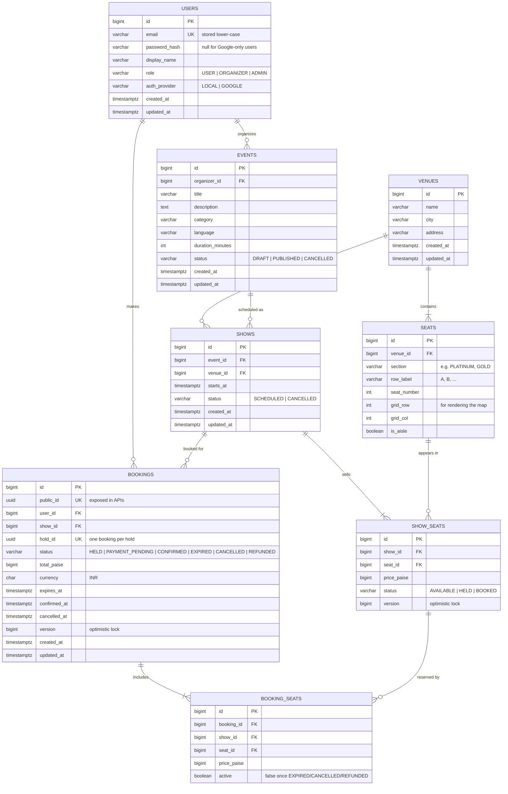
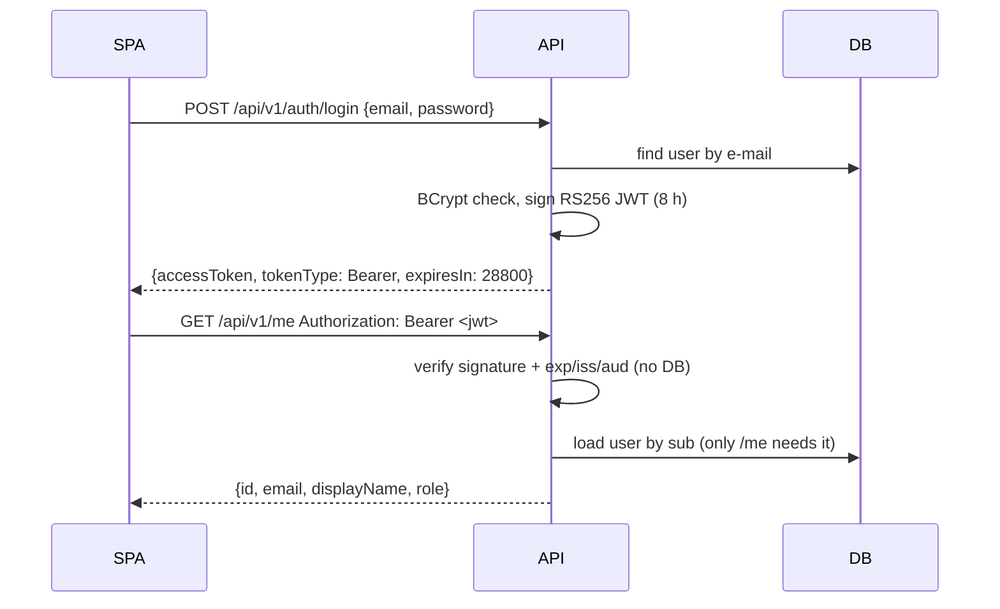
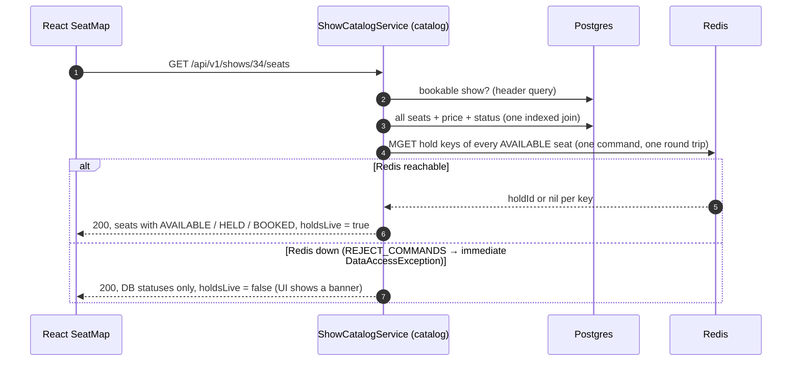
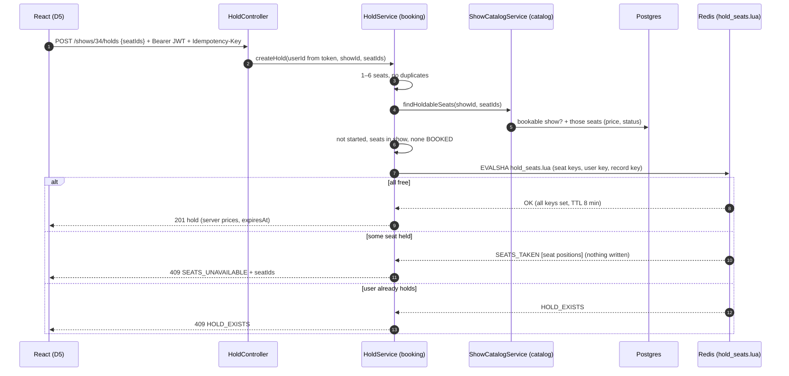
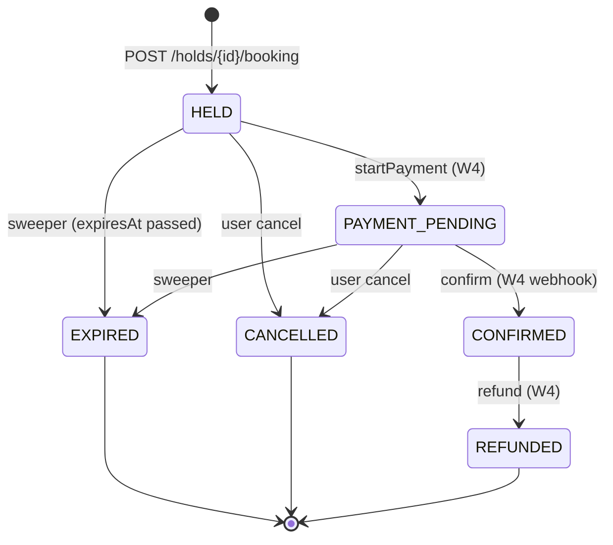
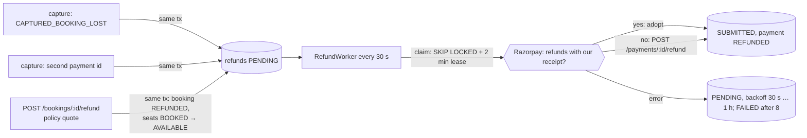
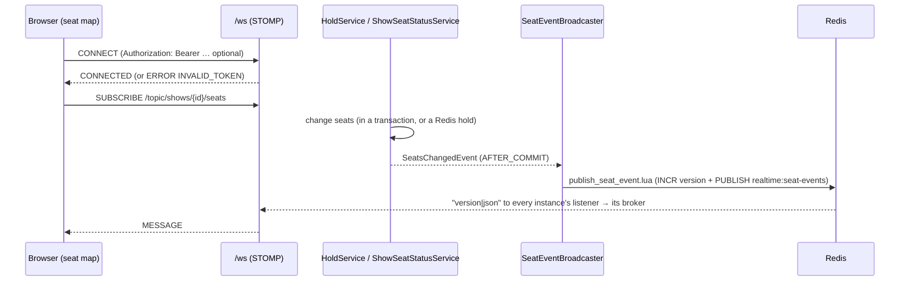

# SeatLock: Architecture

## 1. Data model



## 2. Correctness rules enforced by the schema

| Rule | How |
|---|---|
| One row per seat per show | `UNIQUE (show_id, seat_id)` on `show_seats` |
| **A seat can never be in two live bookings** | **Partial unique index** on `booking_seats (show_id, seat_id) WHERE active`. This is the last line of defense, even if Redis fails. Released seats (`active = false`) can be booked again, and history is kept. |
| A booked seat belongs to that show | Composite FK `booking_seats (show_id, seat_id)` → `show_seats (show_id, seat_id)` |
| A hold becomes at most one booking | `UNIQUE (hold_id)` on `bookings`, which makes confirm idempotent |
| Money is never fractional or negative | `bigint` paise + `CHECK (... >= 0)` / `> 0` |
| Time is unambiguous | `timestamptz` everywhere, UTC in the app (`Instant`) |
| Valid states only | Enums stored as `varchar` + `CHECK (status IN (...))` |
| Concurrent updates detected | `version` columns: `show_seats` (Optimistic strategy), `bookings` (state transitions racing the expiry sweeper / webhooks) |

## 2a. Authentication (W2·D1, see ADR-002)



Public: `GET /api/v1/{events,shows,system}/**`, `POST /api/v1/auth/{register,login}`, health,
Swagger. Everything else requires a valid token (deny by default).

| Route | Who | Gates |
|---|---|---|
| `GET /api/v1/me` | any signed-in user | URL: authenticated |
| `GET /api/v1/organizer/events` | ORGANIZER, ADMIN | URL prefix + `@PreAuthorize`; data scoped to token `sub` |
| `GET /api/v1/admin/users` | ADMIN | URL prefix + `@PreAuthorize` |

Role hierarchy: ADMIN ⊃ ORGANIZER ⊃ USER. Demo logins and admin bootstrap: ADR-002 section 8.

**Google sign-in (W2·D3, ADR-003):** a separate filter chain for `/oauth2/**` and
`/login/oauth2/**` runs the OAuth2 authorization-code flow (PKCE, state in Redis + a binding
cookie, no session). It ends with a 60-second one-time code that the SPA exchanges at
`POST /api/v1/auth/oauth/exchange` for our own JWT; Google's tokens are never used after sign-in.

**Frontend auth:** the token is kept in localStorage (no refresh token, decision #43).
`AuthProvider` loads `/me`, signs out at expiry, on `INVALID_TOKEN` and across tabs; all user data
in the query cache sits under the `['me', …]` key and is dropped on sign-out. `RequireAuth`
guards `/account` and `/organizer/events` (UX only; the API enforces).

## 2b. Caching and venue scheduling (W2·D4)

- **Redis cache (ADR-004):** event detail (5 min) and event list pages (60 s) are cached,
  because benchmarks showed p95 −32% and −21% against the uncached code. The seat map is **not**
  cached: its single indexed query was faster than every cached variant, and it carries live seat
  status. Cache hits never borrow a DB connection; evictions run after commit (`ShowScheduledEvent`).
- **No overlapping shows (CORRECTNESS.md section 1b):** `shows.ends_at` = start + duration + 30 min, and
  the exclusion constraint `ex_shows_venue_no_overlap` makes two scheduled shows at one venue at
  the same time impossible. Organizers create shows with `POST /api/v1/organizer/events/{id}/shows`
  (one price per section; ownership from the token).

## 2c. Live seat map (W3·D1)

`GET /api/v1/shows/{id}/seats` merges two sources into one response:

| Source | Holds | Lifetime | Wins? |
|---|---|---|---|
| Postgres `show_seats.status` | **BOOKED** (and the layout, prices) | durable | always |
| Redis `hold:show:{showId}:seat:{seatId}` → `holdId` | **HELD** | key TTL (the TTL *is* the hold) | only turns AVAILABLE into HELD |



- **Module direction:** catalog defines the port `SeatHoldLookup`; booking implements it
  (`booking.hold.SeatHoldReader`, key schema in `HoldKeys`). Dependencies run booking → catalog only.
- **No transaction around the request:** each query borrows a connection for itself, so no DB
  connection is held while waiting on Redis (a hung Redis can't drain the Hikari pool).
- **Never cached** (ADR-004) and sent with `Cache-Control: no-store`. Measured cost of the overlay:
  none beyond noise (`benchmarks.md` section 2).
- **Fail fast:** Lettuce `REJECT_COMMANDS` while disconnected; Redis down costs ~5 ms instead of the
  500 ms command timeout (`FAILURES.md` F1). Being shown as AVAILABLE while Redis is down is safe:
  the hold script (W3·D2) and the DB oversell guard still reject a taken seat.
- **UI:** `/shows/:showId` renders rows as CSS grids by `gridCol` (aisle = skipped column), section
  headings with prices, native `<button>` seats with `aria-pressed` and a symbol per state. Selection
  is client-only until holds exist (D2 API, D5 UI) and is derived from the latest map, so a seat taken
  by someone else drops out. Refetch on focus + Refresh button until WebSocket push (W5).

## 2d. Seat holds (W3·D2, ADR-006)

| Endpoint | Who | Result |
|---|---|---|
| `POST /api/v1/shows/{showId}/holds` `{"seatIds":[…]}` | signed in | 201 `{holdId, showId, seats, totalPaise, expiresAt}` · 409 `SEATS_UNAVAILABLE` (+ `seatIds`) / `HOLD_EXISTS` / `SHOW_STARTED` · 400 `TOO_MANY_SEATS` / `DUPLICATE_SEATS` / `UNKNOWN_SEATS` / `NO_SEATS` · 503 `HOLDS_UNAVAILABLE` |
| `GET /api/v1/holds/{holdId}` | owner | 200, else 404 |
| `DELETE /api/v1/holds/{holdId}` | owner | 204, else 404 |



- **Idempotency (W3·D3, ADR-007):** `POST /holds` requires `Idempotency-Key`. The `@Idempotent` interceptor runs
  after authorization: claim the key in `idempotency_keys` → run → store the 2xx response (replayed for 24 h with
  `Idempotent-Replayed: true`). Same key + different body → 422; duplicate while running → 409
  `IDEMPOTENCY_IN_PROGRESS`; failure → key released. Expired keys are deleted hourly.
- The seat map (section 2c) reads the same seat keys, so a new hold shows as HELD on the next fetch.
- No DB transaction around the request; booking only calls catalog's public service (booking → catalog).

## 2e. Bookings (W3·D4, ADR-008)

| Endpoint | Who | Result |
|---|---|---|
| `POST /api/v1/holds/{holdId}/booking` | hold owner | 201 + `Location` (new) / 200 (already converted) · 404 hold expired or not mine · 409 `SEATS_UNAVAILABLE` |
| `GET /api/v1/bookings/{publicId}` | owner | 200, else 404 |
| `POST /api/v1/bookings/{publicId}/cancel` | owner | 200 `CANCELLED` (also when already cancelled) · 409 `INVALID_BOOKING_TRANSITION` |



- Conversion: one transaction (`show_seats` → HELD, booking + active `booking_seats`), then the Redis hold is released.
- Leaving a live state (EXPIRED / CANCELLED / REFUNDED) deactivates `booking_seats` and sets the seats AVAILABLE.
- Sweeper: every 30 s, `FOR UPDATE SKIP LOCKED` batches; user actions take a row lock. Seat statuses change only
  through catalog's `ShowSeatStatusService`.

## 2f. Rate limiting and the hold flow in the UI (W3·D5, ADR-009)

- `POST /holds` has `@RateLimited("holds")`: Bucket4j token buckets in Redis, per IP (30/min) then per user
  (burst 5, 10/min) → 429 `RATE_LIMITED` + `Retry-After`; fails open if Redis is unreachable.
- Request order on `POST /holds`: Spring Security → rate-limit interceptor → `@Idempotent` → `HoldService`.

```mermaid
sequenceDiagram
    autonumber
    actor U as User
    participant SM as Seat map page
    participant API as Backend
    U->>SM: pick seats, "Hold seats"
    SM->>API: POST /shows/{id}/holds (Idempotency-Key = new UUID; auto-retry reuses it)
    alt 201
        API-->>SM: hold (expiresAt)
        SM->>SM: remember holdId (sessionStorage), countdown on server clock (GET /system/time offset)
        U->>SM: "Proceed to pay"
        SM->>API: POST /holds/{holdId}/booking
        API-->>SM: 201/200 booking
        SM->>U: /bookings/{publicId}: countdown, Cancel, polling every 10 s while unpaid
    else 409 SEATS_UNAVAILABLE / HOLD_EXISTS / 429 / SHOW_STARTED
        API-->>SM: problem+json (seatIds / holdId / Retry-After)
        SM->>U: mark taken seats · resume existing hold · wait N s · "show has started"
    end
```

- The seat map shows the user's own held seats as "✓ Your hold"; F5 resumes a hold from `sessionStorage`
  (`GET /holds/{id}`; 404 → forgotten). Countdowns use the server's clock, not the laptop's.

## 2g. Payment orders (W4·D1, ADR-010)

- `payment` module: `PaymentGateway` port (`MockGateway`, `RazorpayGateway` on `RestClient`), `Payment` attempts (V8),
  `PaymentService`, `POST /api/v1/bookings/{publicId}/payment-order` (no body: the amount is computed on the server).
- Dependencies: `payment → booking` (only `BookingService.checkPayable` / `startPayment` and the `PayableBooking`
  record) `→ catalog`. No entity crosses a module boundary.
- At most one open or successful payment per booking: `ux_payments_live_booking`; failed attempts are history.

```mermaid
sequenceDiagram
    autonumber
    actor U as User
    participant API as PaymentController
    participant PS as PaymentService
    participant BS as BookingService
    participant GW as PaymentGateway
    participant DB as Postgres
    U->>API: POST /bookings/{publicId}/payment-order
    API->>PS: createOrder(userId, publicId)
    PS->>BS: checkPayable (owner, HELD/PAYMENT_PENDING, before expiresAt, amount from seats)
    PS->>DB: open payment for this booking?
    alt open order exists
        PS-->>U: 200 same order
    else none
        PS->>GW: createOrder(receipt, amountPaise, INR) (no transaction held)
        GW-->>PS: order_...
        PS->>DB: BEGIN
        PS->>BS: startPayment (SELECT ... FOR UPDATE, re-check, HELD → PAYMENT_PENDING)
        PS->>DB: open payment now? (a concurrent request may have won)
        PS->>DB: INSERT payments (attempt n, CREATED); COMMIT
        PS-->>U: 201 order (orderId, amountPaise, payBy)
    end
```

### Checkout in the browser (W4·D2)

```mermaid
sequenceDiagram
    autonumber
    actor U as User
    participant BP as Booking page
    participant API as Backend
    participant RZ as Razorpay
    U->>BP: Pay ₹…
    BP->>API: POST /bookings/{publicId}/payment-order
    API->>RZ: POST /v1/orders (Basic auth, amount from the server, 2 s / 5 s timeouts)
    RZ-->>API: order_…
    API-->>BP: 201/200 {orderId, amountPaise, payBy, keyId}
    BP->>RZ: load checkout.js (first time), open modal (key, order_id, timeout = time left)
    U->>RZ: pays (test mode: netbanking mock bank / test card)
    RZ-->>BP: handler {razorpay_payment_id, razorpay_order_id, razorpay_signature}
    BP->>U: "Confirming your booking…" (poll; CONFIRMED after server-side verification, W4·D3)
```

- The browser never sends an amount, and its success callback is only a claim; the backend decides (D3).
- `payment.failed` inside the modal shows the reason and Razorpay lets the user retry the same order; closing the
  modal keeps the seats until the timer runs out, and "Pay" again reopens the same open order (200).

## 2h. Payment confirmation (W4·D3, ADR-011)

```mermaid
sequenceDiagram
    autonumber
    participant BP as Booking page
    participant RZ as Razorpay
    participant API as Backend
    participant DB as Postgres
    RZ-->>BP: Checkout success {order_id, payment_id, signature}
    par checkout callback
        BP->>API: POST /payments/razorpay/verify
        API->>API: HMAC(key_secret, order_id|payment_id) ok? caller owns the booking?
    and webhook (at least once, any order)
        RZ->>API: POST /webhooks/razorpay (raw body, X-Razorpay-Signature, X-Razorpay-Event-Id)
        API->>API: HMAC(webhook_secret, raw body) ok?
        API->>DB: INSERT webhook_events ON CONFLICT DO NOTHING (same transaction as below)
    end
    API->>DB: BEGIN; SELECT payment FOR UPDATE; CREATED → CAPTURED
    API->>DB: SELECT booking FOR UPDATE; PAYMENT_PENDING → CONFIRMED; show_seats HELD → BOOKED; COMMIT
    API-->>BP: {outcome: CONFIRMED | ALREADY_DONE | CAPTURED_BOOKING_LOST | NEEDS_REVIEW, booking}
```

- Whoever locks the payment row first confirms; the other path finds it done (`ALREADY_DONE`).
- The sweeper locks only the booking: if it wins, the capture records `CAPTURED_BOOKING_LOST` (refund on W4·D4).

## 2i. Refunds and paid cancellation (W4·D4, ADR-012)



- `payment.failed` only records the reason: the order stays open for a retry in Checkout.
- Policy (config): ≥ 48 h → 100 %, ≥ 24 h → 50 %, less → not cancellable; round down.

## 2j. Live seat events (W5·D1, ADR-014)



- Publishers: `HoldService` (HELD with `holdExpiresAt`, AVAILABLE on release) and `ShowSeatStatusService`
  (every DB change: booking HELD, confirm BOOKED, expiry/cancel/refund AVAILABLE). No WebSocket code in those modules.
- Inbound rules (`StompAuthChannelInterceptor`): optional JWT on CONNECT, seat topics only (max 10), no SEND.
- Across instances (W5·D2): the broadcaster runs `publish_seat_event.lua` (INCR + PUBLISH on `realtime:seat-events`);
  every instance's listener forwards each message, in order on one thread, to its own broker.
- Resync: the seat map carries `version` (read before the statuses); clients apply only messages with a greater version
  and reload the map on a gap, a smaller version (Redis restart) or a reconnect.

## 3. Conventions
- Internal keys are `bigint` identity. Bookings expose a random `public_id` (UUID), so IDs in URLs can't be enumerated.
- Enums are `varchar` + `CHECK`, not Postgres `ENUM` types: easier to evolve with Flyway, and mapped with `@Enumerated(EnumType.STRING)`.
- Prices are set per section when an organizer creates a show and copied into `show_seats.price_paise`. A booking stores the price it was charged in `booking_seats.price_paise`, so later price edits never change past bookings.
- `created_at` / `updated_at` are filled by Spring Data auditing using the app's UTC `Clock`.
- FK columns used in joins are indexed in V1. Query indexes for listing/search come on W1·D5, measured with `EXPLAIN ANALYZE` before/after.
- Tables for idempotency keys (W3), payments (W4) and AI audit (W7) arrive in later migrations.