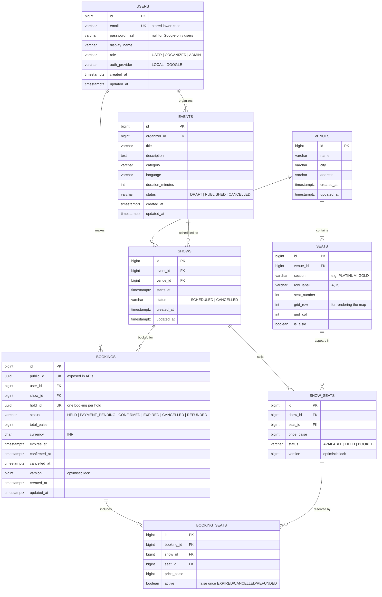
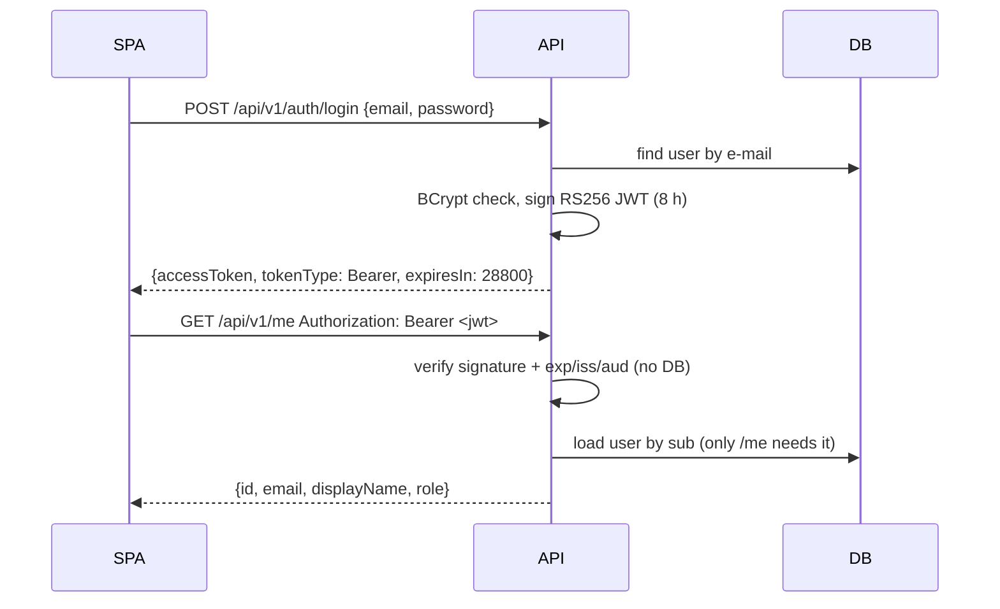

# SeatLock: Architecture

## 1. Data model

## 2. Correctness rules enforced by the schema

| Rule | How |
|---|---|
| One row per seat per show | `UNIQUE (show_id, seat_id)` on `show_seats` |
| **A seat can never be in two live bookings** | **Partial unique index** on `booking_seats (show_id, seat_id) WHERE active`. This is the last line of defense, even if Redis fails. Released seats (`active = false`) can be booked again, and history is kept. |
| A booked seat belongs to that show | Composite FK `booking_seats (show_id, seat_id)` → `show_seats (show_id, seat_id)` |
| A hold becomes at most one booking | `UNIQUE (hold_id)` on `bookings`, which makes confirm idempotent |
| Money is never fractional or negative | `bigint` paise + `CHECK (... >= 0)` / `> 0` |
| Time is unambiguous | `timestamptz` everywhere, UTC in the app (`Instant`) |
| Valid states only | Enums stored as `varchar` + `CHECK (status IN (...))` |
| Concurrent updates detected | `version` columns: `show_seats` (Optimistic strategy), `bookings` (state transitions racing the expiry sweeper / webhooks) |

## 2a. Authentication (W2·D1, see ADR-002)

Public: `GET /api/v1/{events,shows,system}/**`, `POST /api/v1/auth/{register,login}`, health,
Swagger. Everything else requires a valid token (deny by default).

| Route | Who | Gates |
|---|---|---|
| `GET /api/v1/me` | any signed-in user | URL: authenticated |
| `GET /api/v1/organizer/events` | ORGANIZER, ADMIN | URL prefix + `@PreAuthorize`; data scoped to token `sub` |
| `GET /api/v1/admin/users` | ADMIN | URL prefix + `@PreAuthorize` |

Role hierarchy: ADMIN ⊃ ORGANIZER ⊃ USER. Demo logins and admin bootstrap: ADR-002 §8.

## 3. Conventions
- Internal keys are `bigint` identity. Bookings expose a random `public_id` (UUID), so IDs in URLs can't be enumerated.
- Enums are `varchar` + `CHECK`, not Postgres `ENUM` types: easier to evolve with Flyway, and mapped with `@Enumerated(EnumType.STRING)`.
- Prices are set per section when an organizer creates a show and copied into `show_seats.price_paise`. A booking stores the price it was charged in `booking_seats.price_paise`, so later price edits never change past bookings.
- `created_at` / `updated_at` are filled by Spring Data auditing using the app's UTC `Clock`.
- FK columns used in joins are indexed in V1. Query indexes for listing/search come on W1·D5, measured with `EXPLAIN ANALYZE` before/after.
- Tables for idempotency keys (W3), payments (W4) and AI audit (W7) arrive in later migrations.