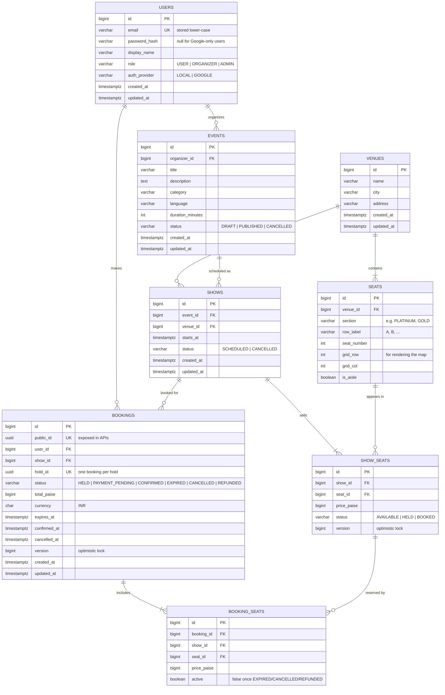
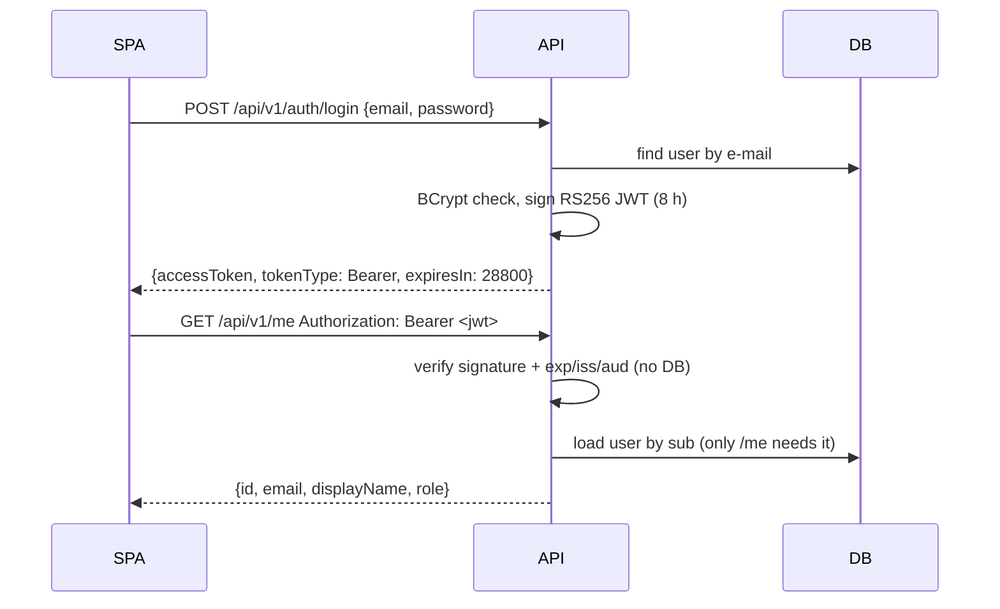
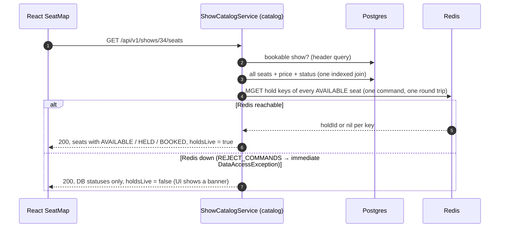
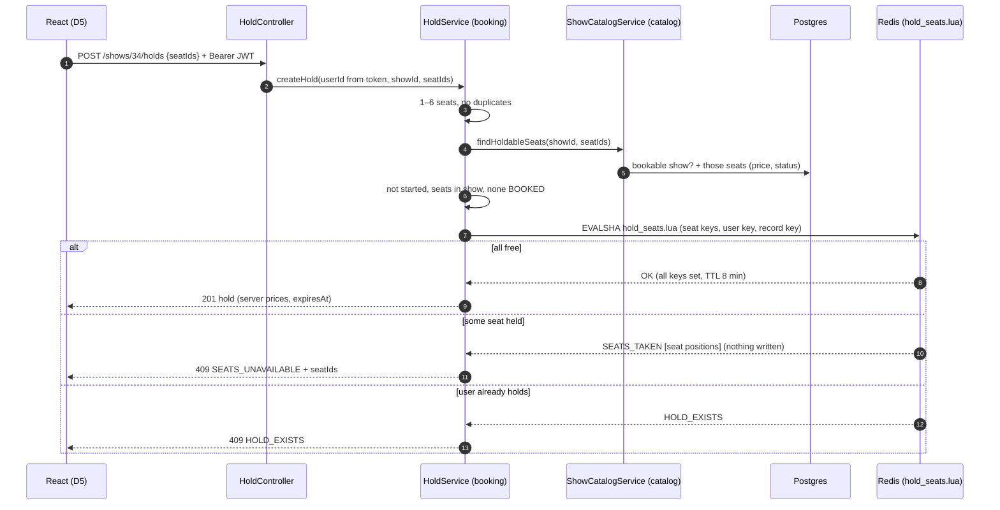

# SeatLock: Architecture

## 1. Data model

## 2. Correctness rules enforced by the schema

| Rule | How |
|---|---|
| One row per seat per show | `UNIQUE (show_id, seat_id)` on `show_seats` |
| **A seat can never be in two live bookings** | **Partial unique index** on `booking_seats (show_id, seat_id) WHERE active`. This is the last line of defense, even if Redis fails. Released seats (`active = false`) can be booked again, and history is kept. |
| A booked seat belongs to that show | Composite FK `booking_seats (show_id, seat_id)` → `show_seats (show_id, seat_id)` |
| A hold becomes at most one booking | `UNIQUE (hold_id)` on `bookings`, which makes confirm idempotent |
| Money is never fractional or negative | `bigint` paise + `CHECK (... >= 0)` / `> 0` |
| Time is unambiguous | `timestamptz` everywhere, UTC in the app (`Instant`) |
| Valid states only | Enums stored as `varchar` + `CHECK (status IN (...))` |
| Concurrent updates detected | `version` columns: `show_seats` (Optimistic strategy), `bookings` (state transitions racing the expiry sweeper / webhooks) |

## 2a. Authentication (W2·D1, see ADR-002)

Public: `GET /api/v1/{events,shows,system}/**`, `POST /api/v1/auth/{register,login}`, health,
Swagger. Everything else requires a valid token (deny by default).

| Route | Who | Gates |
|---|---|---|
| `GET /api/v1/me` | any signed-in user | URL: authenticated |
| `GET /api/v1/organizer/events` | ORGANIZER, ADMIN | URL prefix + `@PreAuthorize`; data scoped to token `sub` |
| `GET /api/v1/admin/users` | ADMIN | URL prefix + `@PreAuthorize` |

Role hierarchy: ADMIN ⊃ ORGANIZER ⊃ USER. Demo logins and admin bootstrap: ADR-002 §8.

**Google sign-in (W2·D3, ADR-003):** a separate filter chain for `/oauth2/**` and
`/login/oauth2/**` runs the OAuth2 authorization-code flow (PKCE, state in Redis + a binding
cookie, no session). It ends with a 60-second one-time code that the SPA exchanges at
`POST /api/v1/auth/oauth/exchange` for our own JWT; Google's tokens are never used after sign-in.

**Frontend auth:** the token is kept in localStorage (no refresh token, decision #43).
`AuthProvider` loads `/me`, signs out at expiry, on `INVALID_TOKEN` and across tabs; all user data
in the query cache sits under the `['me', …]` key and is dropped on sign-out. `RequireAuth`
guards `/account` and `/organizer/events` (UX only; the API enforces).

## 2b. Caching and venue scheduling (W2·D4)

- **Redis cache (ADR-004):** event detail (5 min) and event list pages (60 s) are cached,
  because benchmarks showed p95 −32% and −21% against the uncached code. The seat map is **not**
  cached: its single indexed query was faster than every cached variant, and it carries live seat
  status. Cache hits never borrow a DB connection; evictions run after commit (`ShowScheduledEvent`).
- **No overlapping shows (CORRECTNESS.md §1b):** `shows.ends_at` = start + duration + 30 min, and
  the exclusion constraint `ex_shows_venue_no_overlap` makes two scheduled shows at one venue at
  the same time impossible. Organizers create shows with `POST /api/v1/organizer/events/{id}/shows`
  (one price per section; ownership from the token).

## 2c. Live seat map (W3·D1)

`GET /api/v1/shows/{id}/seats` merges two sources into one response:

| Source | Holds | Lifetime | Wins? |
|---|---|---|---|
| Postgres `show_seats.status` | **BOOKED** (and the layout, prices) | durable | always |
| Redis `hold:show:{showId}:seat:{seatId}` → `holdId` | **HELD** | key TTL (the TTL *is* the hold) | only turns AVAILABLE into HELD |

- **Module direction:** catalog defines the port `SeatHoldLookup`; booking implements it
  (`booking.hold.SeatHoldReader`, key schema in `HoldKeys`). Dependencies run booking → catalog only.
- **No transaction around the request:** each query borrows a connection for itself, so no DB
  connection is held while waiting on Redis (a hung Redis can't drain the Hikari pool).
- **Never cached** (ADR-004) and sent with `Cache-Control: no-store`. Measured cost of the overlay:
  none beyond noise (`benchmarks.md` §2).
- **Fail fast:** Lettuce `REJECT_COMMANDS` while disconnected; Redis down costs ~5 ms instead of the
  500 ms command timeout (`FAILURES.md` F1). Being shown as AVAILABLE while Redis is down is safe:
  the hold script (W3·D2) and the DB oversell guard still reject a taken seat.
- **UI:** `/shows/:showId` renders rows as CSS grids by `gridCol` (aisle = skipped column), section
  headings with prices, native `<button>` seats with `aria-pressed` and a symbol per state. Selection
  is client-only until holds exist (D2 API, D5 UI) and is derived from the latest map, so a seat taken
  by someone else drops out. Refetch on focus + Refresh button until WebSocket push (W5).

## 2d. Seat holds (W3·D2, ADR-006)

| Endpoint | Who | Result |
|---|---|---|
| `POST /api/v1/shows/{showId}/holds` `{"seatIds":[…]}` | signed in | 201 `{holdId, showId, seats, totalPaise, expiresAt}` · 409 `SEATS_UNAVAILABLE` (+ `seatIds`) / `HOLD_EXISTS` / `SHOW_STARTED` · 400 `TOO_MANY_SEATS` / `DUPLICATE_SEATS` / `UNKNOWN_SEATS` / `NO_SEATS` · 503 `HOLDS_UNAVAILABLE` |
| `GET /api/v1/holds/{holdId}` | owner | 200, else 404 |
| `DELETE /api/v1/holds/{holdId}` | owner | 204, else 404 |

- The seat map (§2c) reads the same seat keys, so a new hold shows as HELD on the next fetch.
- No DB transaction around the request; booking only calls catalog's public service (booking → catalog).

## 3. Conventions
- Internal keys are `bigint` identity. Bookings expose a random `public_id` (UUID), so IDs in URLs can't be enumerated.
- Enums are `varchar` + `CHECK`, not Postgres `ENUM` types: easier to evolve with Flyway, and mapped with `@Enumerated(EnumType.STRING)`.
- Prices are set per section when an organizer creates a show and copied into `show_seats.price_paise`. A booking stores the price it was charged in `booking_seats.price_paise`, so later price edits never change past bookings.
- `created_at` / `updated_at` are filled by Spring Data auditing using the app's UTC `Clock`.
- FK columns used in joins are indexed in V1. Query indexes for listing/search come on W1·D5, measured with `EXPLAIN ANALYZE` before/after.
- Tables for idempotency keys (W3), payments (W4) and AI audit (W7) arrive in later migrations.